 

**🧭 关于我 · About me**  
我在做 Control：一个让多个 AI 像团队一样协作干活的工作台。  
Building Control, a workspace where AI works like a team.

**🛠️ 正在做 · Building now**  
Control · AI Team Control Center，面向个人、小团队与创作工作室。  
For individuals, small teams and creative studios.

**📡 找到我 · Find me**  
下面这些平台都能联系到我，欢迎交流。  
Reach me on the platforms below, friendly messages welcome.

 

  
  
  

 

## 🧩 项目展示 · Showcase

> 一个面向个人、小团队和创作工作室的 AI 工作台：多模型协作、编程、设计、项目管理与自动化，集中在同一个控制台里完成。
>
> An AI-powered workspace for individuals, small teams and creative studios: multi-model collaboration, coding, design, project management and automation, all from one console.

🚧 **开源准备中 · Open-sourcing soon**  
关注这个账号，不错过发布。  
Follow this account so you don't miss the release.

<!-- 仓库公开后，在上面这段后面加上这一行：
[⭐ View Control on GitHub](https://github.com/KhanLinHao/ldb-ai-team-control-center)
-->
